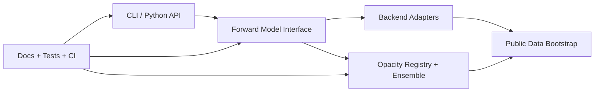

# Tierra+

**Open inference infrastructure for exoplanet atmospheric retrieval and near-Earth object characterization.**

Tierra+ is a production-oriented Python package for calibrated atmospheric retrieval workflows,
opacity-model comparison, backend-agnostic forward modeling, and the scientific provenance needed
to support mission teams working with public spectra. The repository centers on typed library
interfaces, a CLI surface, reproducible data bootstrap paths, and public docs.

[](LICENSE)
[](#building-and-local-setup)

## Start Here

1. install Python `3.11` via `uv`
2. run `uv sync --dev`
3. run `uv run pytest -q`
4. run `uv run tierra-plus --help`
5. build the docs with `LC_ALL=C LANG=C uv run sphinx-build -M html docs docs/_build`

## What This Repository Ships Today

- typed domain models for spectra, atmospheric states, backend configuration, and opacity metadata
- a stable forward-model interface with adapter stubs for unresolved backends
- an opacity registry and bootstrap path for public benchmark assets
- Bayesian model averaging for comparing candidate opacity models
- public Sphinx documentation and CI for linting, typing, tests, and docs builds

## What Is Not Shipped Yet

- a resolved upstream `tierra` submodule or fork
- live `petitRADTRANS` backend execution
- any scientific result that has not been reproduced with public inputs and passing tests
- JWST notebooks

## Architecture



## Building And Local Setup

```bash
git clone https://github.com/salma2vec/tierra-plus.git
cd tierra-plus
uv python install 3.11
uv sync --dev
```

## Quickstart

```bash
uv run pytest -q
uv run tierra-plus --version
uv run tierra-plus retrieve \
  --backend tierra \
  --mode transmission \
  --temperature-k 500.0 \
  --radius-rjup 0.25 \
  --gravity-ms2 9.8 \
  --composition-json '{"H2O": 0.2, "N2": 0.8}'
```

The initial CLI returns an integration error until a canonical `tierra` source is selected and
wired in.

## Commands Overview

```text
uv sync --dev
uv run pytest -q
uv run mypy src
uv run ruff check .
uv run black --check .
LC_ALL=C LANG=C uv run sphinx-build -M html docs docs/_build
uv run python scripts/bootstrap_public_data.py --verify-only
```

## Repository Structure

```text
tierra-plus/
├── docs/
├── data/public/
├── plans/
├── scripts/
├── src/tierra_plus/
│   ├── forward/
│   ├── inference/
│   ├── contamination/
│   ├── output/
│   ├── provenance/
│   └── neo/
├── tests/
└── .github/workflows/
```

## Documentation

- Public docs live in [`docs/`](docs/)
- Backend integration status and contract notes live in [`docs/backend-integration.md`](docs/backend-integration.md)
- Execution plans live in [`plans/`](plans/)
- Continuation work is tracked in [`BACKLOG.md`](BACKLOG.md)

## Scientific Integrity

- No fabricated replication claims
- Public data only unless the repository explicitly documents otherwise
- Priors remain configurable rather than hardcoded into the package surface
- Missing integrations fail loudly with actionable remediation steps
