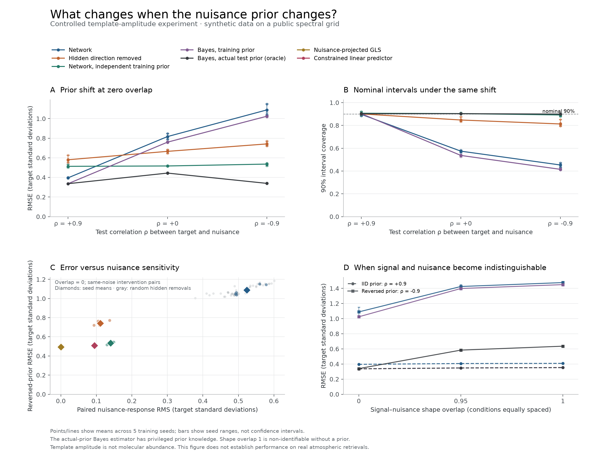

# First causal reliability experiment

**Prior-shift failure reproduced; the proposed hidden-direction correction failed
its acceptance criteria.** Five of five primary runs supported H1. Zero of five
supported H2, with no inconclusive primary fits. Keep the audit; do not promote
this correction as a reliable retrieval method.

These are synthetic template-amplitude experiments on the public WASP-39b spectral
grid. They are not an atmospheric abundance retrieval, a molecular detection or
evidence of failure in an existing physical retrieval system.

## Fixed experiment and provenance

The [protocol](../../../docs/causal-reliability-protocol.md),
[configuration](../../configs/causal-reliability-v1.json) and measured source were
committed before the main run at
[`733dc0d`](https://github.com/Vectigen/tierra-plus/commit/733dc0dccc7e8704d78f11e0916fd1d879fb3adb).
This is a local prospective specification, not an external preregistration.
The source was clean when execution started at 2026-10-14 12:56:52 UTC. No model,
threshold or intervention was selected after inspecting these test results.

The study used five seeds (11, 23, 42, 71, 101), three target/nuisance shape overlaps
(0, 0.95, 1), and training correlation +0.9. Each run used 8192 training, 1024
validation, 1024 discovery and 4096 test objects. Test correlations +0.9, 0 and -0.9
reuse the same latent/noise draws, as do overlap comparisons within a seed.
All 15 cases and all ten random controls per case are retained.

The original public spectral assets are described and licensed in
[the data record](../../data/wasp39-prism/README.md). The experiment verifies their
bytes and uses 127 preselected bins, the published error scale and PICASO template
shape. It never uses observed transit depths as target labels.

## Primary result: identifiable geometry

The table gives **means across five seeds** at overlap zero. RMSE is in target
standard deviations. Interval coverage is measured against known synthetic truth.
These means are descriptive; the pass/fail rules operate on individual seeds.

| Estimator | IID RMSE | Reversed-prior RMSE | Reversed-prior 90% coverage |
| --- | ---: | ---: | ---: |
| Network | 0.396 | 1.089 | 45.3% |
| Hidden direction removed | 0.580 | 0.742 | 81.3% |
| Network trained with independent nuisances | 0.513 | 0.536 | 89.2% |
| Ridge | 0.339 | 1.025 | 41.2% |
| Exact Bayes, training prior | 0.336 | 1.024 | 41.5% |
| Exact Bayes, actual test prior (oracle) | 0.336 | 0.339 | 89.9% |
| Constrained linear reference | 0.408 | 0.509 | 81.4% |
| Nuisance-projected GLS | 0.495 | 0.495 | 90.4% |

Network IID RMSE ranges from 0.392 to 0.402; reversed-prior RMSE ranges from 1.038
to 1.152. Its nominal 90% coverage falls from a mean of 89.6% to 45.3%
(reversed-prior seed range 43.4–47.2%). Every primary fit passes the fixed quality
gate and satisfies H1's error-growth and coverage-failure requirements.

The exact training-prior Bayes estimator and ridge also fail after prior reversal.
The pattern therefore does not require a distinctive neural mechanism. However,
the network's paired nuisance effects differ from the training-prior oracle by
0.104–0.143 RMS target standard deviations per unit nuisance: **all five exceed
the prespecified 0.1 explanation tolerance**. We cannot claim that prior dependence
fully accounts for the learned model's intervention response. Approximation and
intervention-distribution differences remain to be distinguished.

## The proposed correction is rejected

Hidden-direction removal reduces nuisance response by 72.3–83.9%, retaining
88.8–100.1% of the original signed signal response. It reduces reversed-prior error,
and beats all ten corresponding random removals in every seed on both nuisance
response and reversed-prior RMSE. That is insufficient to pass the frozen gate:

| Seed | Nuisance response retained (must be ≤0.20) | Signal response retained (must be ≥0.80) | IID RMSE / constrained reference (must be ≤1.10) | H2 |
| --- | ---: | ---: | ---: | --- |
| 11 | 0.222 | 0.993 | 1.338 | Fail |
| 23 | 0.187 | 1.001 | 1.422 | Fail |
| 42 | 0.161 | 0.961 | 1.552 | Fail |
| 71 | 0.227 | 0.888 | 1.399 | Fail |
| 101 | 0.277 | 0.929 | 1.396 | Fail |

All five fail the constrained-IID-error criterion; three also miss the 80%
nuisance-reduction criterion. GLS has lower IID error, lower nuisance response and
greater signal response in every primary seed. It uses privileged knowledge of the
design matrix, so this is a controlled reference, not an equally informed deployed
model. The constrained linear reference also has privileged prior/geometry access;
it is not a universal lower bound for nonlinear predictors.

The larger held-out nuisance intervention also leaves a mean response of 0.151
after removal, versus 0.111 at the primary magnitude. A direction discovered with
one intervention size is not guaranteed to suppress other sizes.

## Identifiability control

At overlap 0.95, hidden removal retains only 15.4–29.7% of the original signed
signal response. At exact overlap 1, it retains 10.6–19.0%. Removing nuisance
sensitivity can also remove target information when their spectral signatures
coincide. All five rank-deficient cases correctly refuse the unregularized GLS
estimate, while proper-prior Bayesian posteriors remain finite. Finite posterior
uncertainty is not evidence that the likelihood identifies both amplitudes.



The figure shows seed means and ranges, not confidence intervals. Panel C shows
reversed-prior error; H2's constrained-error criterion instead uses IID error as
reported in the table. The actual-test-prior oracle knows the test correlation.
Its paired intervention reference uses the independent prior, as specified in the
runner. Neural intervals are approximate, fixed validation-RMS Gaussian intervals.

## Inspect or reproduce

- [Full report](report.json): configuration, source/input hashes, runtime, every
  per-seed metric, uncertainty scale, interval count, intervention and decision.
- Each `overlap-*-seed-*` directory contains `summary.json`, `weights.npz` and
  `arrays.npz`. Load NumPy archives with `allow_pickle=False`.
- Archives retain fitted weights/normalizers, discovered and random directions,
  raw float64 main-method predictions and paired effects. Full synthetic noise
  arrays and random-control predictions are regenerated from the recorded PCG64
  seed words, source and runtime; their hashes/controls allow verification.
- [Plotting script](../../plot_causal_reliability.py) reads the saved report without
  retraining. The [SVG](summary.svg) is available for export.

From a clean source checkout:

```bash
uv sync --dev
OPENBLAS_NUM_THREADS=1 OMP_NUM_THREADS=1 VECLIB_MAXIMUM_THREADS=1 \
uv run --with h5py==3.16.0 python -m examples.causal_reliability \
  --config examples/configs/causal-reliability-v1.json \
  --output /tmp/tierra-causal-v1
uv run --with matplotlib python examples/plot_causal_reliability.py \
  --report /tmp/tierra-causal-v1/report.json --output /tmp/tierra-causal-v1/summary.png
```

The run used NumPy on the available Apple M1 Mac, with one BLAS thread. Runtime
versions and source hashes are in the report. Floating-point training can vary
across platforms; archived weights preserve the actual measured models. The output
directory must be new. A dirty source checkout is refused for main runs; `--smoke`
permits a small pipeline check but cannot support either hypothesis.

The next promotion gate is a held-out physical atmosphere simulation grid with a
defensible nuisance intervention and an independently trained retrieval. This
experiment does not validate those physical transformations. Its immediate result
is a reproducible audit that exposes prior-shift failure and rejects an inadequate
internal correction; see the [research gates](../../../BACKLOG.md).
