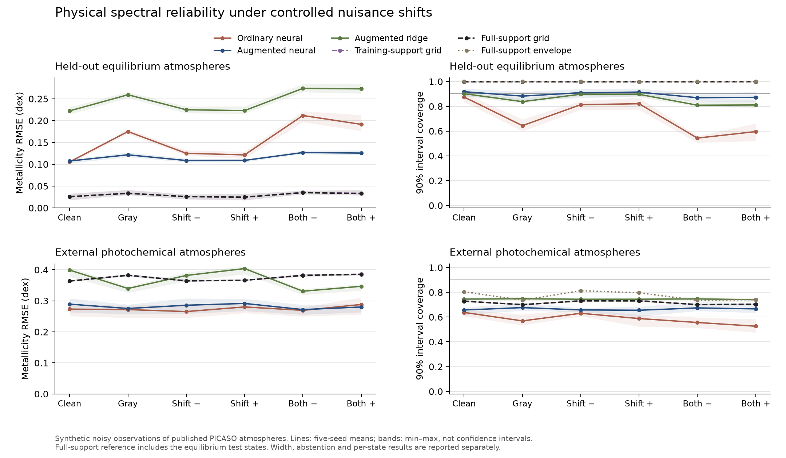

# Physical-grid reliability: bounded benefit, external failure

The frozen nuisance-augmented neural estimator passed its predefined gate in
**4/5 seeds** on unseen equilibrium atmospheres. It improved on matched augmented
ridge, but the training-support physical-grid reference remained substantially
more accurate. **The same learned estimator failed on the external photochemical
atmospheres: nominal 90% coverage averaged 66.5%, while accepting every spectrum.**
The nuisance-aware grid reference also failed under this chemistry change.

**Discrete-grid intervals are not continuous atmospheric uncertainty.** Full-grid
intervals had zero width in 93.74% of primary cases and 90.20% of external cases:
posterior mass concentrated on one of eight metallicity grid labels. High
in-family coverage and tiny widths do not establish precise continuous abundance
measurements or adequate atmospheric physics.

This is synthetic noisy observation of physical PICASO spectra, not a fit to
JWST observed depths. The physical training/calibration/test split is 128/32/32
states. The external challenge contains 116 photochemical states. Five seeds each
use 32 noise draws per heldout state and intervention. Noise repetitions are not
new independent atmospheres.

The [protocol](../../../docs/physical-grid-protocol.md) and
[configuration](../../configs/physical-grid-v1.json) were frozen in commit
`bb3d37b4c76e9fd4b43fd92f55df875728534046` before the main run and external-spectrum
preparation. Main began 2026-10-14 15:26:14 UTC and completed in 118.04 seconds on the
available Mac with one BLAS thread. No thresholds or models were changed after
these outcomes.



Tables summarize all six primary conditions across five seeds. RMSE, coverage,
width and acceptance are unweighted means of seed-condition metrics. Coverage
after abstention pools accepted draws. Abstention requires width ≤ 0.6 dex; the
residual-check control additionally requires its validation-calibrated residual
threshold. Full-support references include the equilibrium test states; the
training-support reference excludes them.

## Held-out equilibrium states

| Method | RMSE (dex) | Coverage | Mean width (dex) | Accepted | Coverage after abstention |
|---|---:|---:|---:|---:|---:|
| Ordinary neural | 0.1551 | 71.6% | 0.3190 | 100.0% | 71.6% |
| Ordinary neural, worst-group interval | 0.1551 | 93.5% | 0.6136 | 40.0% | 91.7% |
| Augmented neural | 0.1165 | 89.5% | 0.3769 | 100.0% | 89.5% |
| Augmented ridge | 0.2461 | 85.9% | 0.7430 | 0.0% | — |
| Full-support grid reference | 0.0296 | 99.9% | 0.0163 | 100.0% | 99.9% |
| Full-support interval envelope | 0.0296 | 100.0% | 0.1112 | 98.9% | 100.0% |
| Training-support grid reference | 0.0298 | 99.9% | 0.0166 | 100.0% | 99.9% |
| Nominal grid + residual rejection | 0.0924 | 92.5% | 0.0196 | 50.0% | 93.9% |

## External photochemical states

| Method | RMSE (dex) | Coverage | Mean width (dex) | Accepted | Coverage after abstention |
|---|---:|---:|---:|---:|---:|
| Ordinary neural | 0.2747 | 58.5% | 0.3190 | 100.0% | 58.5% |
| Ordinary neural, worst-group interval | 0.2747 | 79.2% | 0.6136 | 40.0% | 76.2% |
| Augmented neural | 0.2823 | 66.5% | 0.3769 | 100.0% | 66.5% |
| Augmented ridge | 0.3670 | 74.5% | 0.7430 | 0.0% | — |
| Full-support grid reference | 0.3739 | 71.6% | 0.0381 | 99.7% | 71.5% |
| Full-support interval envelope | 0.3739 | 77.1% | 0.1888 | 95.7% | 76.1% |
| Training-support grid reference | 0.3742 | 71.6% | 0.0384 | 99.7% | 71.5% |
| Nominal grid + residual rejection | 0.4101 | 62.4% | 0.0331 | 18.0% | 89.1% |

## Gates and retained limitations

- Augmented-neural gate: 4/5. Seed 601 failed coverage in gray and both combined
  conditions (84.86%, 83.89%, 83.89%); all five seeds passed the other three
  components. The gate uses a predeclared 85% coverage floor at nominal 90%,
  not an exact calibration assertion.
- Full-support marginal, envelope and training-support marginal references:
  reliability 5/5 within the finite equilibrium experiment. Augmented ridge and
  worst-group calibrated ordinary ridge: 0/5; their intervals exceed the width cap.
- The off-grid secondary shift/dilution condition did not rescue external
  reliability: augmented neural coverage 67.7%, training-support grid 74.8%.
- Width alone failed to flag the chemistry mismatch. Residual rejection improved
  some selected cases but accepted only 18.0% of external draws on average; on the
  external combined-minus condition its accepted coverage was about 74.0%.
  Detection alone does not establish corrected reliable inference.
- The separate physical-grid experiment is now executed. Successful reliability
  under external physics, a continuous physical posterior, fresh radiative
  transfer, realistic instrument/stellar effects and real-data validation remain
  unmet. The original hidden-direction failure remains unchanged in the
  [first study](../causal-reliability/README.md).

The 116 external states are now exposed diagnosis data. They may suggest a new
hypothesis; they cannot serve as untouched validation for a subsequent method.
The next question is whether wavelength-held-out predictive adequacy detects
confident mistakes better than a full-spectrum residual baseline, at a useful
acceptance rate. That requires a new frozen protocol and fresh heldout physics.
[PICASO 4.0](https://arxiv.org/abs/2602.22468) provides a current forward-model
route with expanded cloud/photochemistry treatment; this study uses the explicitly
versioned published PICASO 3.0 grid and does not claim to have run 4.0.

## Reproduce and inspect

The compressed [complete report](report.json.gz) preserves all per-seed/per-state
metrics, gates, exact physical split and input hashes. [record.json](record.json)
records its uncompressed checksum. Fit parameters and raw prediction intervals
are in each seed directory. [Prepared public spectra](../../data/physical-grid/README.md)
are included with their author attribution and transformation provenance.

```sh
# Verify all saved metric/prediction arrays and regenerate the exact draw hashes.
OPENBLAS_NUM_THREADS=1 OMP_NUM_THREADS=1 VECLIB_MAXIMUM_THREADS=1 \
  uv run python -m examples.replay_physical_grid
# Fresh main output, using the frozen configuration and supplied prepared spectra.
OPENBLAS_NUM_THREADS=1 OMP_NUM_THREADS=1 VECLIB_MAXIMUM_THREADS=1 \
  uv run python -m examples.physical_grid_reliability \
  --grid examples/data/physical-grid/rcte \
  --external-grid examples/data/physical-grid/photochemical \
  --output /tmp/tierra-physical-main
# Render only from the recorded result; no estimator reruns.
uv run --with matplotlib python -m examples.plot_physical_grid \
  --report examples/results/physical-grid/report.json.gz --output /tmp/tierra-physical-summary
```

Original raw draws and the uncompressed run are retained unchanged in the research
archive. To avoid redundant binary storage, they are regenerated publicly from
`SeedSequence([681193, fit_seed, split_number])`: split 0 training, 1 calibration,
2 equilibrium test, 3 photochemical. The replay verifies reconstructed NPZ checksums
against the frozen report, in addition to predictions and per-state metrics.
NumPy/runtime changes may affect exact bytes; the report records package versions.
