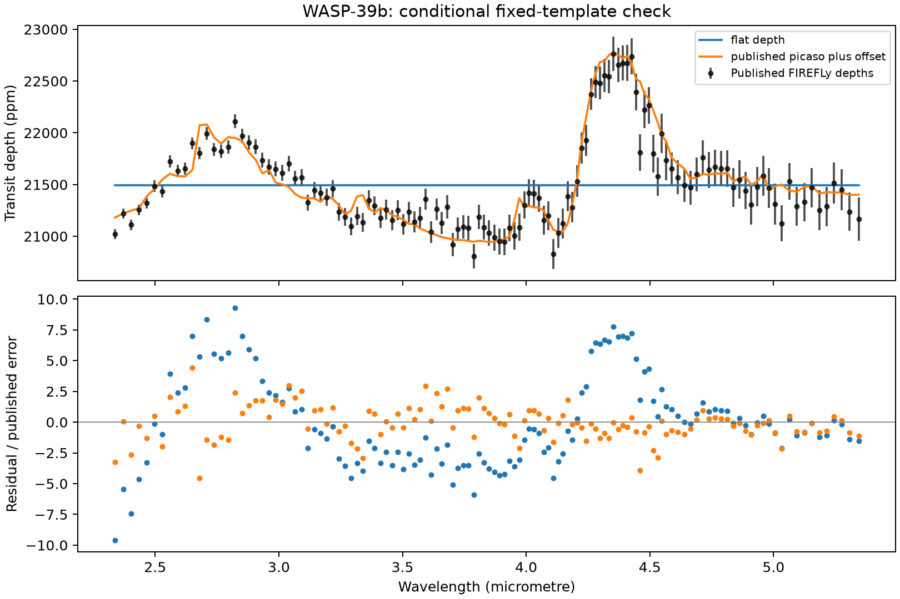

# Real-spectrum conditional check

On 2026-10-14, `examples/wasp39_validation.py` fitted the published FIREFLy
WASP-39b transmission spectrum with two one-parameter models: a constant transit
depth and the original authors' fixed PICASO template plus a depth offset.
Inputs, attribution, license and original-file hashes are recorded
[with the data](../../data/wasp39-prism/README.md). All weighted posterior points,
settings, diagnostics and inputs are retained in `result.json.gz`.

```bash
uv sync --locked --dev --extra inference
uv run --extra inference --with h5py==3.16.0 --with matplotlib \
  python examples/wasp39_validation.py --seed 42 --output /tmp/tierra-wasp39
```

The example retains all 127 bins whose inferred lower edge is at least 2.3 µm,
avoiding the partially saturated region discussed in the publication. It infers
bin edges from adjacent wavelength centers and integrates the piecewise-linear
model with a uniform top-hat response. These are explicit approximations to the
instrument response, not a reproduction of the authors' full reduction.

Both models assume independent published Gaussian errors and a uniform nuisance
parameter prior of width 0.01 in dimensionless depth. The flat-depth prior is
`[0.015, 0.025]`; the template-offset prior is `[-0.005, 0.005]`. The peaks lie far
from the bounds. Each fit uses 200 live points, seed 42 and `dlogz=0.03`, with no
iteration cap. Dynesty emitted no convergence warnings in these runs.

| Diagnostic | Flat depth | Published PICASO + offset |
| --- | ---: | ---: |
| Best-fit χ² / degrees of freedom | 1751.400 / 126 | 247.891 / 126 |
| χ² survival probability under stated assumptions | 4.45 × 10⁻²⁸⁴ | 5.60 × 10⁻¹⁰ |
| Posterior mean minus analytic mean, in analytic σ | 0.0464 | 0.0384 |
| Sampled minus analytic log evidence | 0.2218 | −0.0551 |
| Sampler's log-evidence uncertainty | 0.1753 | 0.1797 |
| Posterior-predictive exceedances / draws | 0 / 2048 | 0 / 2048 |

The sampler agrees with the analytic one-parameter calculation, but **neither
model passes the residual check under this simplified likelihood and binning**.
The published template captures much more spectral structure than the flat null,
yet it leaves excess residual scatter. Zero simulated exceedances is a finite
Monte Carlo outcome, not an exact zero probability.

The conditional log-evidence difference is 751.478 in favor of the fixed template.
That value is **not a molecular detection significance or atmosphere-model Bayes
factor**: the template was selected on these same observations, and atmospheric
parameters, covariance, instrument response and model-selection uncertainty were
not marginalized. This is a useful data-ingestion and conditional-inference check,
with a negative absolute-fit result; it does not validate a full retrieval pipeline.



Executed with Python 3.11, NumPy 2.4.4, dynesty 3.1.0, SciPy 1.17.1 and h5py 3.16.0.
The [2024 uniform ERS analysis](https://doi.org/10.1038/s41550-024-02292-x) provides
an important later comparison, including remaining PRISM saturation effects; this
example deliberately pins the earlier release and does not reproduce that analysis.
